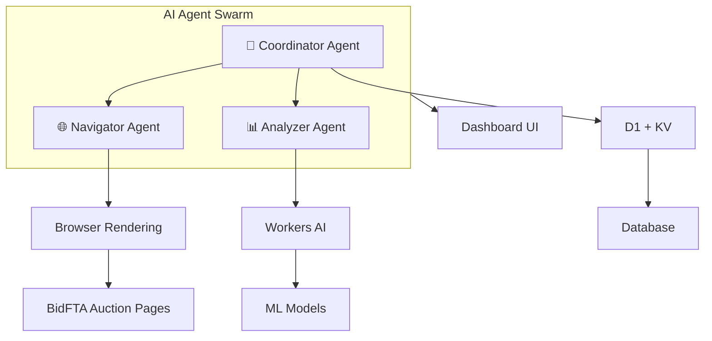
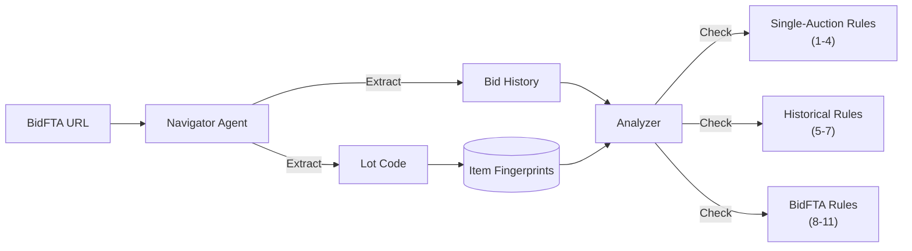

# ShillBid Watchdog:

Automated shill-bid detection using **AI Agent Swarm** on Cloudflare Workers with ML-powered analysis.

---

## Core Architecture



---

## AI Agent Approach

> [!IMPORTANT]
> **Not Scraping – Browsing:** AI agents interact with sites like a human user via Browser Rendering. Each agent autonomously navigates, reads, and extracts visible data. This bypasses traditional anti-scraping because:
>
> 1. Real browser sessions (Puppeteer/Playwright)
> 2. Human-like timing and interaction patterns
> 3. No API abuse – just reading what's publicly visible

---

## Agent Roles

| Agent | Cloudflare Service | Function |
|-------|-------------------|----------|
| **Coordinator** | Workers + Durable Objects | Orchestrates tasks, manages auction queue, schedules monitoring |
| **Navigator** | Browser Rendering + `@cloudflare/puppeteer` | Opens BidFTA pages, navigates to bid history tabs, extracts Lot Code and bid data |
| **Analyzer** | Workers AI | Runs ML models for anomaly detection + 11 rule-based scoring patterns |

---

## Detection Rules (11 Total)

### Single-Auction Rules (1-4)

| # | Rule | Detection |
|---|------|-----------|
| 1 | High Bid Ratio | Bidder participates in >40% of bids |
| 2 | Bid Concentration | Top 2 bidders make >70% of bids |
| 3 | Frequent Pairs | Same pair bids against each other ≥3 times |
| 4 | Bid Inflation | Price increased 5x+ from start |

### Historical Cross-Auction Rules (5-7)

| # | Rule | Detection |
|---|------|-----------|
| 5 | Seller Follower | Same bidder appears in >50% of seller's auctions |
| 6 | Relist Shill | Bidder active on same item across ≥2 relists |
| 7 | Loss Leader | Bidder consistently loses but drives up prices |

### BidFTA-Specific Rules (8-11)

| # | Rule | Detection |
|---|------|-----------|
| 8 | Relist Stalker | Same bidder follows item across multiple relist cycles (via Lot Code) |
| 9 | Penny Sniper | Excessive $0.01 increment bids (max bid exposure) |
| 10 | Never-Pickup | Winning bidders who don't pick up items, causing relists |
| 11 | Serial Loser | Highly active bidders who consistently lose |

---

## Data Flow



---

## ML Foundation (Workers AI)

Built-in from day one using Cloudflare Workers AI:

| Task | Model | Use Case |
|------|-------|----------|
| **Anomaly Detection** | `@cf/baai/bge-base-en-v1.5` | Embed bid patterns, detect outliers via cosine similarity |
| **Classification** | `@cf/microsoft/resnet-50` (adapted) | Classify auction risk levels |
| **Summary** | `@cf/meta/llama-3.2-3b-instruct` | Generate human-readable alert explanations |

Vector embeddings stored in **Vectorize** for pattern matching across historical auctions.

---

## Cloudflare Resources

| Resource | Binding | Purpose |
|----------|---------|---------|
| D1 Database | `DB` | Auction history, bids, bidders, alerts, item fingerprints |
| KV Namespace | `CACHE` | Fast caching layer |
| Vectorize Index | `VECTORS` | Bid pattern embeddings |
| Browser Rendering | `BROWSER` | Real browser sessions for navigation |
| Workers AI | `AI` | ML model inference |
| Durable Objects | `COORDINATOR` | Agent state coordination |

---

## Project Structure

```
├── src/
│   ├── index.ts           # Main worker entry (Hono API)
│   ├── types.ts           # TypeScript definitions
│   ├── rules.ts           # Single-auction detection (Rules 1-4)
│   ├── historical.ts      # Cross-auction detection (Rules 5-7)
│   ├── bidfta.ts          # BidFTA-specific detection (Rules 8-11)
│   └── agents/
│       ├── coordinator.ts  # Durable Object orchestrator
│       ├── navigator.ts    # Browser Rendering agent
│       └── analyzer.ts     # ML + rules analysis
├── public/
│   ├── index.html         # Dashboard
│   ├── styles.css         # Dark theme CSS
│   └── app.js             # Frontend (tabbed UI)
├── schema.sql             # D1 database schema
└── wrangler.toml          # Cloudflare configuration
```

---

## Quick Start

```bash
# Install dependencies
npm install

# Run locally (requires Cloudflare account)
npx wrangler dev

# Deploy
npx wrangler deploy
```

---

## API Endpoints

| Method | Endpoint | Description |
|--------|----------|-------------|
| GET | `/api/health` | Health check |
| POST | `/api/auctions/watch` | Add auction to watch |
| GET | `/api/auctions` | List all auctions |
| GET | `/api/auctions/:id` | Auction details with bids |
| GET | `/api/alerts` | List alerts |
| POST | `/api/alerts/:id/acknowledge` | Acknowledge alert |
| GET | `/api/stats` | Dashboard statistics |

---

## License

MIT
