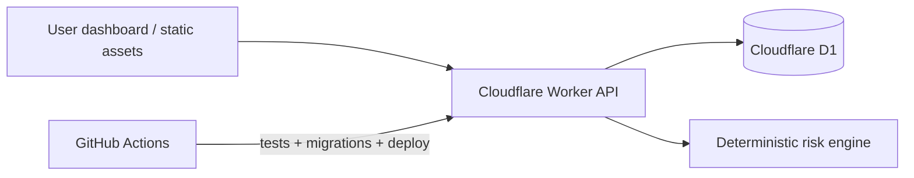

# ◈ ShillBid Watchdog

> An evidence-driven, free-tier auction risk investigation workspace. Cloudflare Workers + D1 + native static assets + GitHub Actions. No paid APIs, hosted databases, third-party auth platform, or browser subscription required.

   

## What works in v2

- **Auction registry:** save an HTTPS listing URL, descriptive name, opening price, seller tag, and notes.
- **Bid import:** paste CSV/TSV bid records in `bidder,amount,time` order (max 200 per auction); data is validated and stored in D1.
- **Deterministic risk engine:** six explainable, auditable rules; no fake AI confidence numbers or unsubstantiated accusations.
- **Historical seller analysis:** optional repeat-bidder analysis across previously observed auctions sharing a seller tag.
- **Evidence workspace:** browseable watchlist, detailed bid chronology, risk levels, supporting rule observations, alert acknowledgement, and deletion.
- **Security:** read and write endpoints require an `ADMIN_TOKEN` secret; browser only stores this token in session storage.
- **GitHub CI/CD:** tests on PRs; additive D1 schema migration and Wrangler deploy on main push if Cloudflare credentials are configured.

### Important limitation

**URL tracking does NOT automatically extract BidFTA data.** The former code relied on Browser Rendering/Puppeteer, a site-dependent automation that could fail, consume free browser minutes, or run into site access restrictions. This restoration replaces the default processing path with reliable user-imported bid histories. Auto-collection can be implemented later as an explicitly opt-in, legally permitted connector with quotas. Until then, the dashboard shows **preview records labelled DEMO DATA** when not connected. It never presents sample alerts as real data.

This tool identifies patterns to inspect, *not* shill bidders. Proxy bidding, masked aliases, omitted bids, missing winners, and auction-specific conventions can all invalidate an inference.

## Architecture



**Required:** Workers Free, one D1 database, GitHub Actions (free for public repositories). **Not required:** Workers AI, Browser Rendering, Vectorize, Durable Objects, KV, Playwright, Python, or a paid plan.

## First deployment (one-time)

1. Sign up for **Cloudflare Workers Free**, not Workers Paid. The existing `wrangler.toml` references the project's original D1 database ID. If you are using a different Cloudflare account, first run `npx wrangler d1 create shillbid-watchdog-db` and replace `database_id` in `wrangler.toml` with the returned ID. Do **not** commit account credentials.
2. From the project root: `npm install`, `npx wrangler login`, `npm run db:remote`, and `npx wrangler secret put ADMIN_TOKEN` (use a random token with 16+ characters; preferably 32+). Then run `npm run deploy`.
3. On the GitHub repository, set **Actions secrets**: `CLOUDFLARE_API_TOKEN` (a narrowly scoped Worker deployment and D1 permission token) and `CLOUDFLARE_ACCOUNT_ID` (Cloudflare account ID). The deploy workflow then applies additive migrations and deploys every push to `main`.
4. Open the `workers.dev` deployment address, select **Connect workspace**, and enter the same `ADMIN_TOKEN` configured in Cloudflare (not the CI API token).

### Local run

```bash
npm install
npm run db:local
# Create .dev.vars with ADMIN_TOKEN=your-long-random-token
npm run dev
npm test
```

Do not commit `.dev.vars`. The administrator token is never needed by GitHub Actions. The Worker stores it as a Cloudflare secret.

### Data import

```csv
bidder,amount,time
BIDDER-1,10.00,2026-10-16 10:01
BIDDER-2,11.00,2026-10-16 10:02
BIDDER-1,12.00,2026-10-16 10:03
```

Use chronological **earliest-to-latest** order. Importing replaces the previous recorded history for that auction and recalculates its risk. Copy only data you are allowed to obtain. Bidder aliases are not confirmed personal identities.

## Detection model

| Rule | Threshold | Weight |
| --- | --- | ---: |
| Bidder concentration | At least 45% of 6+ bids from one account | 21 |
| Two-bidder concentration | At least 75% of 8+ bids from two accounts | 14 |
| Repeated alternating pair | At least 5 back-to-back transitions between the same pair | 18 |
| Large price multiple | Observed high bid at least 5× documented opening (3+ bids) | 12 |
| One-cent increments | At least 3 one-cent increases in 6+ records | 12 |
| Seller follower | Frequent account present in >=3 other observed auctions from tagged seller and at least 60% of those auctions | 20 |

Levels: `NONE` (0), `LOW` (1–24), `MEDIUM` (25–44), `HIGH` (45–64), `CRITICAL` (65+). Scores are heuristic prioritizations, not probabilities or ML predictions.

## API

Health (`GET /api/health`) is public. All other routes require `Authorization: Bearer <ADMIN_TOKEN>`.

| Method | Route | Purpose |
| --- | --- | --- |
| GET | `/api/auctions`, `/api/stats`, `/api/alerts` | Dashboard queries |
| POST | `/api/auctions` | Register a listing |
| GET | `/api/auctions/:id` | Auction and bid evidence |
| POST | `/api/auctions/:id/bids` | Import/replace recorded bids and analyze |
| POST | `/api/auctions/:id/analyze` | Recalculate from stored bids |
| DELETE | `/api/auctions/:id` | Soft-delete auction and clear its bids/alerts |
| POST | `/api/alerts/:id/acknowledge` | Mark a finding reviewed |

### Security and operational notes

- Run a private workspace: any holder of `ADMIN_TOKEN` can access **all** data and mutate it. Do not share this token. Rotate through Cloudflare `wrangler secret put ADMIN_TOKEN` after compromise.
- No public CORS wildcard. Mutation APIs accept JSON and validate amounts, lengths, URL protocols, and record limits.
- App is *single administrator*, not multi-user. No bidder identity deanonymization, fraud allegations, evasion methods, or automatic external fetches.
- Free-plan quotas apply to Worker requests and D1 daily rows. If exhausted, requests fail rather than incurring overage on the Free plan. Cloudflare and GitHub may change their terms.
- Existing v1 tables stay in D1; the additive migration creates missing tables and a separate `auction_notes` table without deleting historical auctions.
- **Old repository assets**: historic source files are retained for reference; v2 runs from `src/worker.mjs`, `src/engine.mjs`, and `public/` only. Committed `node_modules` are removed from version control in the restoration commit.

## Verification

`npm test` uses Node's built-in test runner and has no runtime dependencies. CI runs these tests and JavaScript syntax validation on every PR before deployment.

## Licensing

Repository's original MIT intent; retain copyright notices in existing source files.
